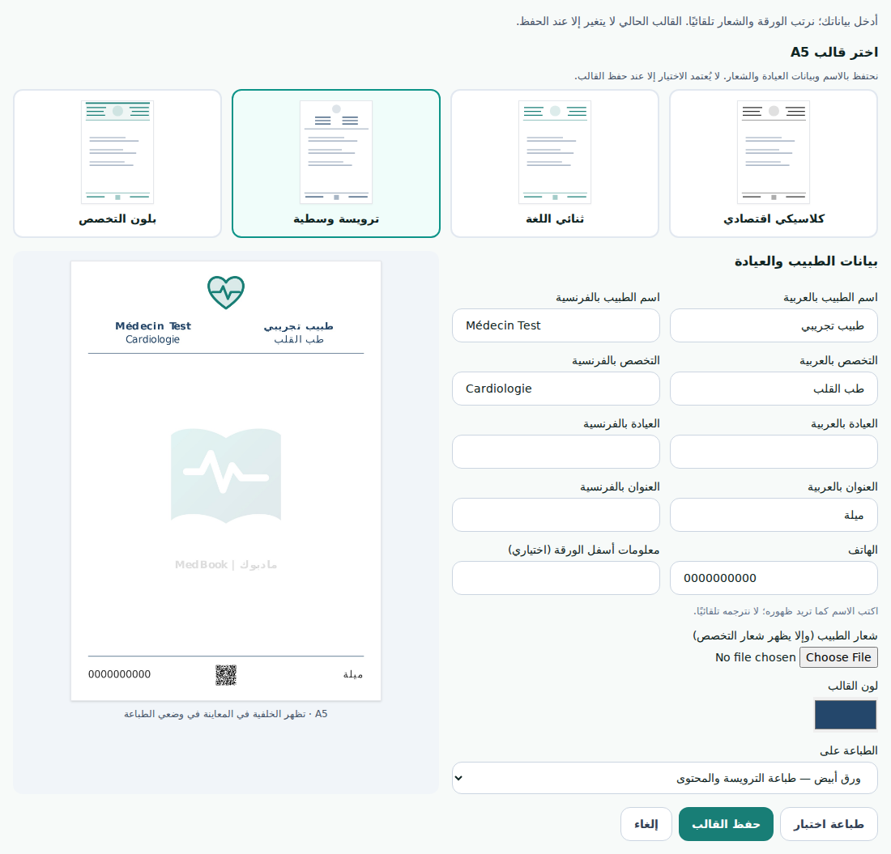
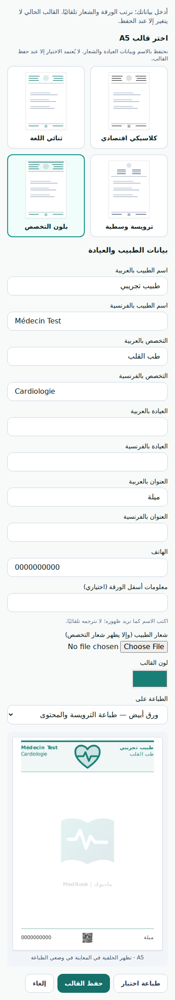

# Ready-made A5 prescription layouts

Doctors can choose Classic, Bilingual, Centred or Specialty accent under Prescription settings → My A5 template → Choose/customise a template. These are original MedBook layouts inspired by common prescription stationery patterns; no third-party product designs or assets were copied.

Selections preserve bilingual identity, clinic details, the personal logo, existing extra elements and the selected blank/preprinted mode. The account template changes only on explicit save. Existing templates without a preset remain supported. The classic layout omits the large watermark for economical printing. The other layouts retain MedBook branding and booking QR. These layouts do not add signatures or stamps.

The optional preset field is validated by the existing backend JSON schema; no Prisma migration or paid dependency is introduced. Deploy the backend schema before exposing the new frontend to avoid preset saves being rejected by an older strict validator.

Validation: frontend build, 140 frontend tests, backend TypeScript build, and 29 targeted backend schema/route tests passed. Local Chromium checked all four choices, rendered save payloads and the 390px mobile viewport with no horizontal overflow or browser errors. Test data only; no production patient records used.

Specialty logo research is recorded separately in [the 63-specialty candidate list](../specialty-logo-research-20261018.md). The existing logo implementation has not been replaced.
