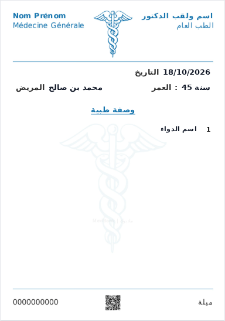
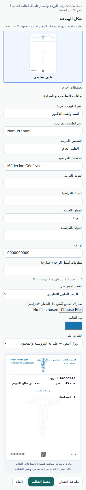

# Traditional prescription stationery and imported forms

The supplied 1152×1536 JPEG (about 89 KB) passed the original client import check. Its reported rejection could not be reproduced, so no specific production cause is asserted. The old editor hid save errors behind a generic message.

Changes:
- Detect actual JPEG/PNG/WebP file headers, including mobile files with missing MIME or image/jpg. Accept portrait sheets up to 10 MB and fit the full sheet into A5 without stretching/cropping; optimise the output within the existing API limit.
- Preserve the imported draft after save failure and display specific errors for expired authentication, server size limits and network failures.
- Support full preprinted forms with configurable positions for date, full patient name and age, omitting duplicate metadata labels and the prescription title. The full name remains one field; no guessing how a name should split into surname/given name.
- Offer a traditional blue layout and an explicit choice of classical medical emblem, specialty icon or none. Existing templates and custom logos remain preserved. Show actual rendered stationery thumbnails and a complete illustrative prescription preview, rather than schematic placeholder cards.

The Caduceus path is by Rama / Eliot Lash, from https://commons.wikimedia.org/wiki/File:Caduceus.svg (public domain / CC0), also documented by the creator at https://openclipart.org/detail/2913/caduceus. Path data is retained; viewport and colour are parameterised. It is bundled locally, with no external image requests at print time. No generated raster artwork is used.

Validation: frontend production build and 142 tests; backend TypeScript build and 25 targeted schema/ownership/route tests. Local Chromium imported the exact reference using image/jpg, exercised a 413 save failure without losing the draft, saved/reopened the template, and verified three printed-value overlays with no duplicate title. Captured real canvas payloads passed the backend schema. The sample printed to one A5 page. Traditional layout and 390px mobile display were checked without browser errors or horizontal overflow.

The supplied user reference and derived screenshots of it are not included in this repository. Screenshots below use synthetic demonstration identities only. This change does not alter a doctor's saved template until they explicitly save.

Deploy backend validation before the frontend. The new optional JSON fields require no database migration or paid service.

